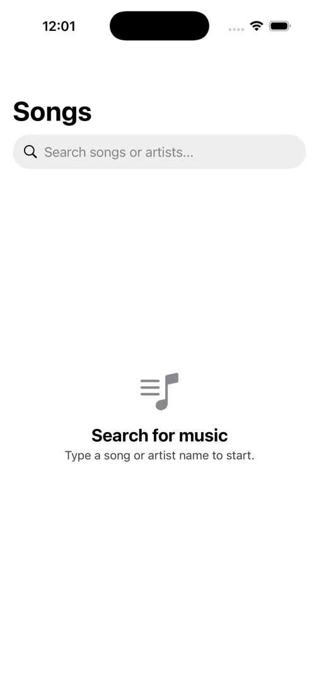
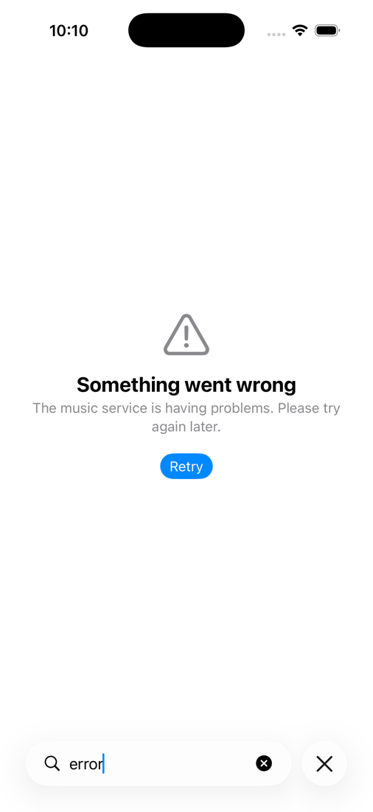
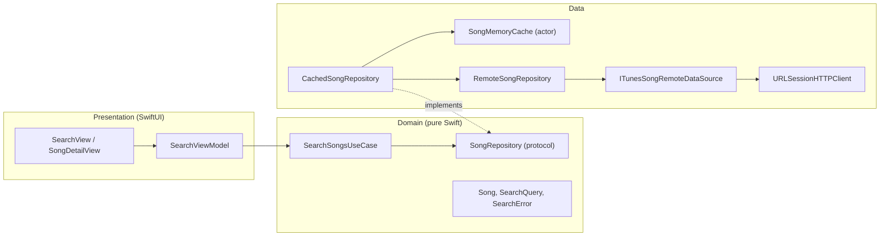
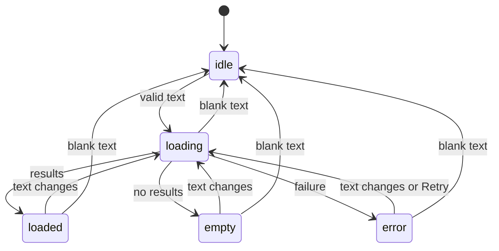
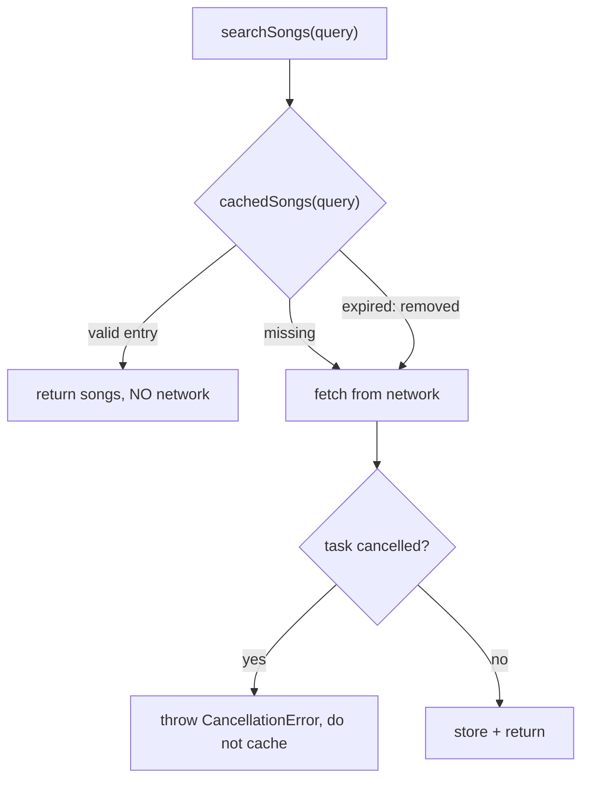

# iTunesSearchApp

A native iOS song-search app: you type, results appear in a list, and tapping a song opens its detail.
Swift 6 (strict concurrency), SwiftUI, iOS 17.6+, no third-party dependencies.

  
  
  
  
  

## API

[iTunes Search API](https://developer.apple.com/library/archive/documentation/AudioVideo/Conceptual/iTuneSearchAPI/): public, no key. Filtering is done by the server; no `country` is sent, so prices are USD.
`https://itunes.apple.com/search?term={query}&entity=song&limit=25`

## Run and test

Open `iTunesSearchApp.xcodeproj` (Xcode 26), pick the **iTunesSearchApp** scheme and an iOS 17.6+ simulator, and run with ⌘R. **⌘U** runs everything:

- **`iTunesSearchAppTests`** (Swift Testing): Domain with a mocked repository, Data (cache hit, expiry, cancellation down to a real `URLSession` via a `URLProtocol` stub, error mapping), Presentation (debounce, cancellation, stale results, VoiceOver announcements, formatting, String Catalog). No real network, no real sleeping.
- **`iTunesSearchAppUITests`** (XCTest): search → detail → back, Apple's accessibility audit on every screen state and at the largest Dynamic Type size, and a Spanish launch that guards the localization. They run offline with `-UITestStubbedSearch` (Debug only).

`iTunesSearchApp.xctestplan` forces English and disables parallelism, because the unit tests compare English texts.

| Requirement | Where |
|---|---|
| Search screen, results list | `SearchView` (`.searchable` + `List`) |
| Cancel in-flight search, never show old results | `SearchViewModel` ([Cancellation](#cancellation)) |
| Detail with 3+ fields | `SongDetailView`: album, genre, release date, duration, price |
| Cache per query with TTL, no network on a hit | `CachedSongRepository` + `SongMemoryCache` (3 min) |
| Domain tests with mocks / Data cache tests | `SearchSongsUseCaseTests` / `SongMemoryCacheTests`, `CachedSongRepositoryTests` |

## Architecture

Three layers, each a module of the local Swift package `Packages/SearchKit`: `Presentation → Domain ← Data`. **The compiler enforces it**: `Presentation` and `Data` depend only on `Domain`, so `Presentation` cannot import `Data`. Only the app target (the composition root) knows all three.

- **Domain** is pure Swift and defines the protocols Data implements. Each module exposes only what the composition root needs; the rest is `internal` and tested with `@testable`.
- Dependencies are injected through initializers; no singletons. Entities are immutable `Sendable` structs, the cache is an `actor`, the view model is `@MainActor @Observable`.
- Network, HTTP and decoding failures become a typed `SearchError` in Data; the UI only shows a localized message and a Retry button.
- **One search:** the view model cancels the previous task and waits 300 ms; the use case turns the text into a `SearchQuery` and calls `CachedSongRepository`, which answers from the cache or goes to the network (see [Cache](#cache)).

### Screen states

Exactly one of five states (`SearchViewState`): `idle` welcome prompt, `loading` progress, `loaded` list, `empty` no-results view, `error` message with **Retry**. Every arrow into `loading` drops the previous list, empty view or error, so old results are never visible while a new search is pending.

## Decisions

### Cancellation

- Every text change cancels the previous task at once. Blank text goes back to `idle` with no task and no network; anything else waits 300 ms (debounce, injected `Clock`) and calls the use case.
- After each `await` the task checks `Task.isCancelled`: a cancelled search never reaches the screen even if it answers late, and a `CancellationError` is never shown as an error.
- Cancellation reaches the network: `URLError(.cancelled)` becomes `CancellationError` in Data, and a test with a real `URLSession` proves the request is actually stopped.

### Cache

- In memory, keyed by `SearchQuery` (trimmed, inner whitespace collapsed, lowercased). Diacritics are **not** folded: "cafe" and "café" can return different results, so they get different entries.
- **TTL 3 minutes**, configurable; time comes from an injected `CacheClock`, so tests check expiry in milliseconds. Only successful responses are cached, never errors or cancelled requests.
- `CachedSongRepository` is a stateless decorator that only decides cache or network. It awaits the wrapped repository directly, so cancelling the caller cancels the whole chain.

### Accessibility and localization

- Each row is one VoiceOver element with label and hint, and the outcome of every search is announced (result count, no results, error) through an injectable announcer. Layouts switch from horizontal to vertical stacks at accessibility Dynamic Type sizes and adapt to iPhone landscape and iPad.
- English and Spanish. The String Catalog lives in the `Presentation` module and every text is looked up in that module's bundle. The app also ships a tiny `InfoPlist.xcstrings`: it is what declares the app as localized, and without it iOS stays in English on a Spanish device.

### Left out on purpose

The brief asks for a simple exercise, so these were considered and dropped:

- **Request coalescing:** the view model already cancels the previous search and the debounce prevents overlap, so there is nothing to share; it would also complicate cancellation.
- **Cache size limit, pagination, image caching:** only expired entries are purged (3 min TTL), the API returns up to 25 songs, and artwork uses `AsyncImage`.
- **A second API call for the detail (`/lookup`):** the search response already has everything the detail shows, so a second call would add only latency, loading/error states, cancellation, a failure when offline and more tests.

## How it was built

Built with an AI coding assistant (Claude Code); `CLAUDE.md` holds the conventions I gave it. I set the requirements, chose between its proposals, reviewed the code and ran the tests and the app myself.

## Known limitations

- At most 25 results per search; prices are always USD. The detail artwork depends on Apple's `100x100bb` URL format.
- Verified on simulators only: iOS 26.4 (iPhone 17 and iPad, light and dark mode) and iOS 17.5 (iPhone 15, with the deployment target lowered to 17.0); not on a real device or on iOS 17.6 to 25. The accessibility audits exempt anything inside the system search field and the keyboard, which the app cannot change. Spanish has not been reviewed by a native speaker.
- The package targets iOS only.
