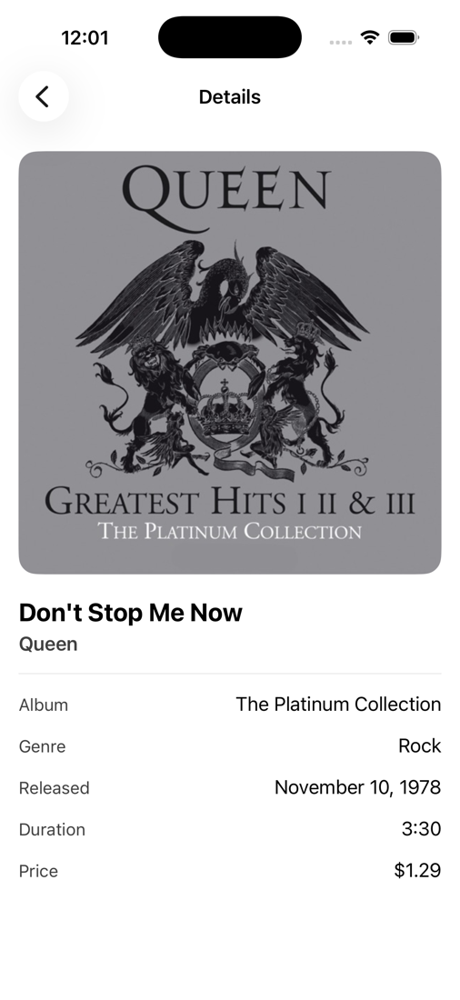
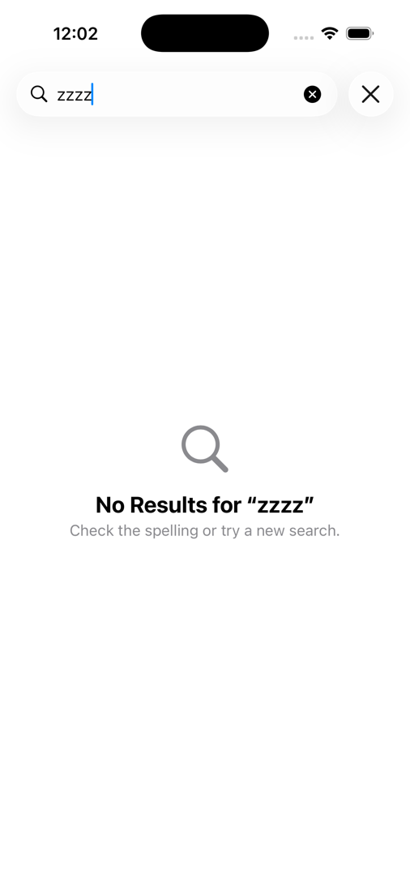
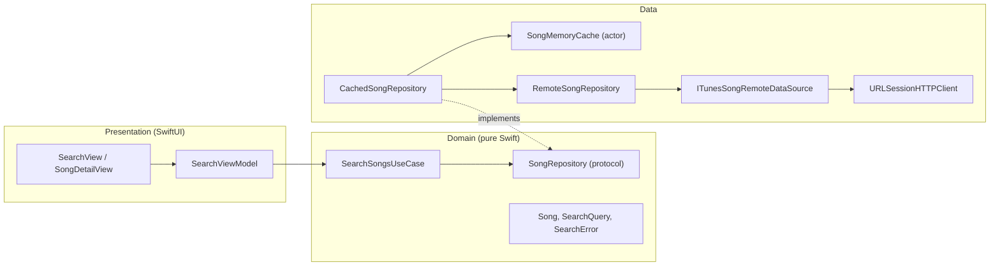
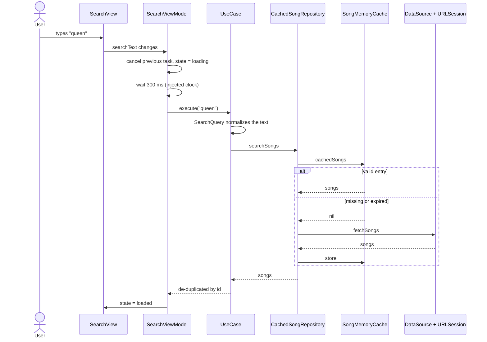
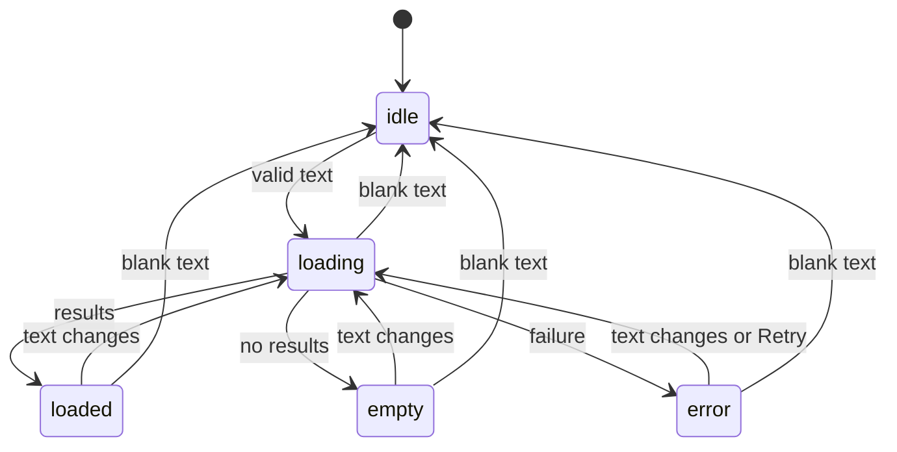
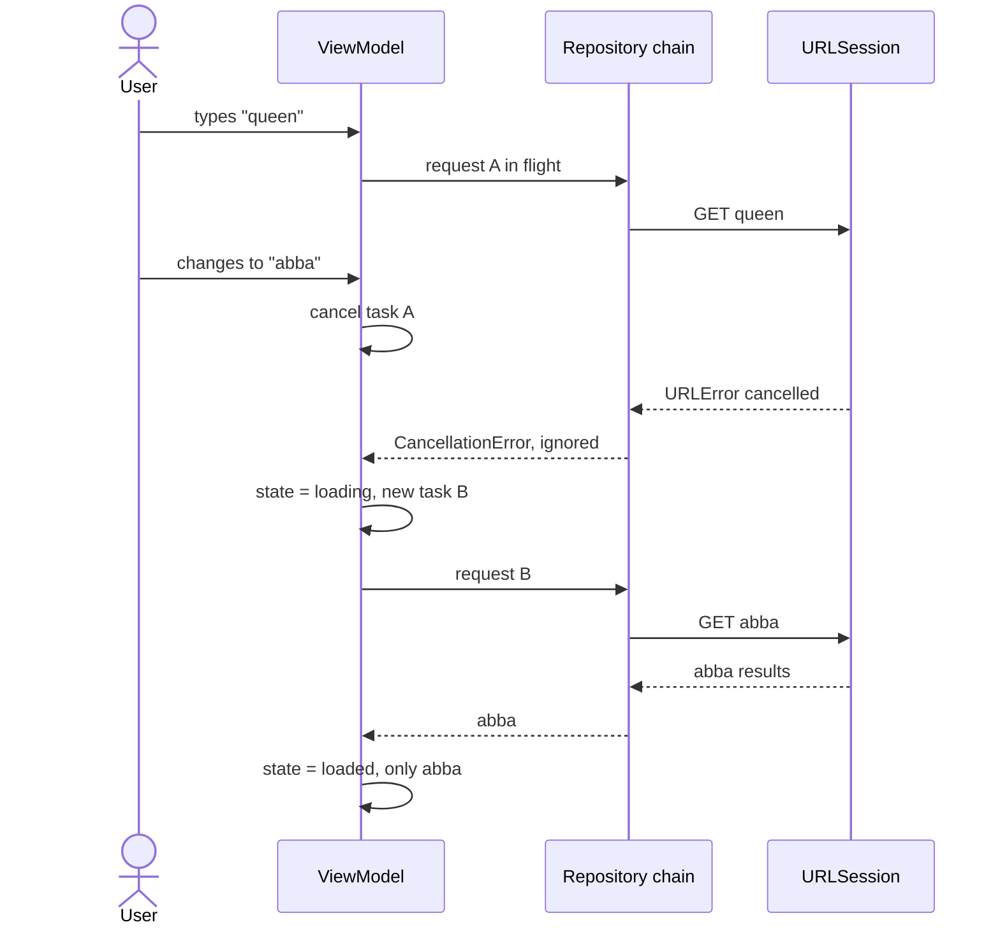
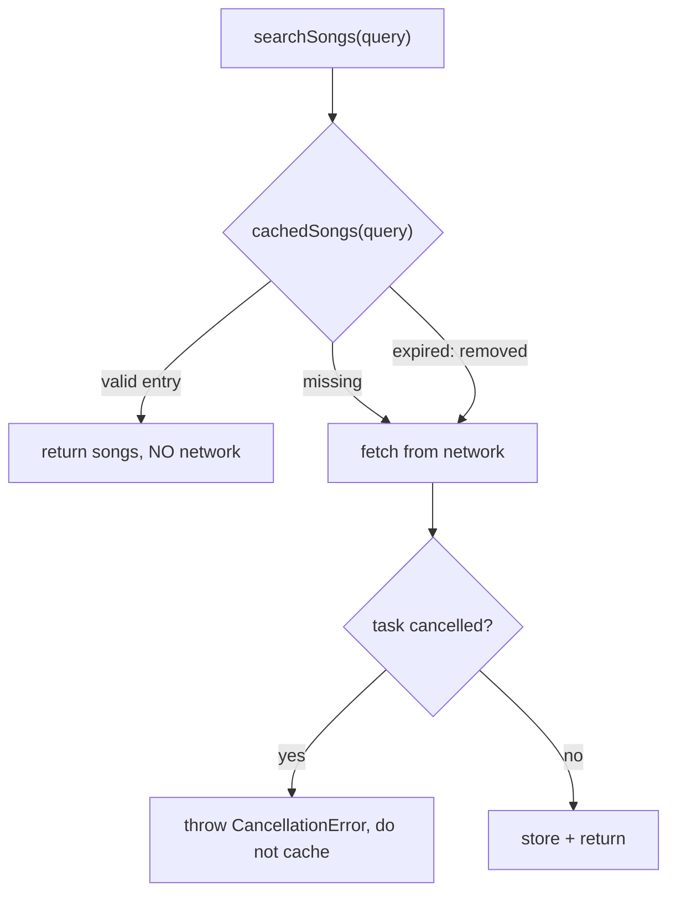

# iTunesSearchApp

A native iOS song-search app. You type, results appear in a list, and tapping a song opens its detail.

<p>
  
  
  
  
  
</p>

Swift 6 (strict concurrency), SwiftUI, iOS 17.6+, no third-party dependencies.

## Public API

[iTunes Search API](https://developer.apple.com/library/archive/documentation/AudioVideo/Conceptual/iTuneSearchAPI/): public, no key, no sign-up.

```
https://itunes.apple.com/search?term={query}&entity=song&limit=25
```

Filtering is done by the server. No `country` is sent, so results and prices come from the US store (USD).

## How to run

1. Open `iTunesSearchApp.xcodeproj` (Xcode 26).
2. Pick the **iTunesSearchApp** scheme and an iOS 17.6+ simulator or device.
3. Run with ⌘R.

### Tests

⌘U in Xcode, or:

```bash
xcodebuild test -project iTunesSearchApp.xcodeproj -scheme iTunesSearchApp \
  -destination 'platform=iOS Simulator,name=iPhone 17'
```

| Target | Framework | What it covers |
|---|---|---|
| `iTunesSearchAppTests` | Swift Testing | Domain (use case with a mocked repository), Data (cache hit, expiry, cancellation, real `URLSession` through a `URLProtocol` stub), Presentation (view model), localization. No real network, no real sleeping. |
| `iTunesSearchAppUITests` | XCTest | Search → detail → back navigation, plus Apple's accessibility audit on every screen state and at the largest Dynamic Type size. English only. |

- UI tests run offline: the app is launched with `-UITestStubbedSearch` (Debug builds only) and uses fixed songs.
- `iTunesSearchApp.xctestplan` forces the test language to English and disables parallel execution. The unit tests compare English texts, so they depend on that plan.

## Requirements → where they are

| Requirement | Where |
|---|---|
| Search screen with a text field and a results list | `SearchView` (`.searchable` + `List`) |
| Cancel the in-flight search; never show old results | `SearchViewModel` (see [Cancellation](#cancellation)) |
| Detail screen with 3+ fields | `SongDetailView`: album, genre, release date, duration, price |
| Data / Domain / Presentation separation | [Architecture](#architecture) |
| Cancellable async search | Structured concurrency from the view model down to `URLSession` |
| Per-query cache with TTL, no network on a hit | `CachedSongRepository` + `SongMemoryCache` (3 min) |
| Domain tests with mocked repositories | `SearchSongsUseCaseTests` + `SongRepositorySpy` |
| Data tests for the cache | `SongMemoryCacheTests`, `CachedSongRepositoryTests` |
| Presentation tests (optional) | `SearchViewModelTests`, formatter and accessibility tests |

## Architecture

Three layers in one target. Dependencies point inwards: `Presentation → Domain ← Data`. Only the composition root knows all three.



```
iTunesSearchApp/
  App/            Composition root (builds the object graph) and the UI-test stub
  Domain/         Song, SearchQuery, SearchError, SongRepository, SearchSongsUseCase
  Data/           HTTP client, DTOs and mapper, iTunes data source, cache, repositories
  Presentation/   SearchViewModel, SearchView, SongDetailView and components
```

- **Domain** imports neither SwiftUI nor anything network-related. It defines the protocols that Data implements, so the dependency points at Domain.
- **Dependency injection** through initializers with protocols. No singletons.
- **Swift 6:** entities are immutable `Sendable` structs, the cache is an `actor`, the view model is `@MainActor @Observable`.
- **Real graph:** `URLSessionHTTPClient → ITunesSongRemoteDataSource → RemoteSongRepository → CachedSongRepository(SongMemoryCache) → DefaultSearchSongsUseCase → SearchViewModel → SearchView`.

### One search, end to end



### Screen states

The search screen is always in exactly one of five states (`SearchViewState`), so impossible combinations cannot exist.



| State | What the user sees |
|---|---|
| `idle` | "Search for music" prompt |
| `loading` | Progress indicator |
| `loaded` | List of songs |
| `empty` | "No results" view |
| `error` | Localized message and a **Retry** button |

Every arrow into `loading` drops the previous list, empty view or error. Old results are never visible while a new search is pending.

## Decisions

### Cancellation

- Every text change cancels the previous task immediately. Blank text goes back to `idle` with no task and no network.
- Otherwise the new task waits 300 ms (debounce) on an injected `Clock`, then calls the use case.
- After each `await` the task checks `Task.isCancelled`: a result from a cancelled search never reaches the screen, even if it arrives late. A `CancellationError` is never shown as an error.
- Cancellation reaches the network: `URLError(.cancelled)` is mapped to `CancellationError` in Data, and a test with a real `URLSession` proves the request is actually stopped.



### Cache

- In memory, keyed by `SearchQuery`: trimmed, inner whitespace collapsed, lowercased. Diacritics are **not** folded: "cafe" and "café" can return different results from the server, so they get different entries.
- **TTL: 3 minutes**, configurable through the initializer. An entry whose age equals the TTL is already expired.
- Time comes from an injected `CacheClock`, so tests check expiry in milliseconds.
- Only successful responses are cached: never errors, never the result of a cancelled request.



`CachedSongRepository` is a stateless decorator around any `SongRepository`: it only decides cache or network. It awaits the wrapped repository directly, so cancelling the caller cancels the whole chain down to the request.

### Errors

Network, HTTP and decoding failures are translated to `SearchError` in the Data layer. The UI never sees a raw error: it shows a localized message and a Retry button.

### Accessibility and localization

- English and Spanish (`Localizable.xcstrings`); a test checks both languages have the same keys and format specifiers.
- Each row is a single VoiceOver element with a label and hint; artwork is hidden from VoiceOver; errors are announced.
- Dynamic Type: layouts switch from horizontal to vertical stacks at accessibility sizes. Contrast is checked by the accessibility audit.
- The layout also adapts to iPhone landscape and iPad (content width is limited on large screens, and on iPad the search field is pinned under the title instead of floating in the corner).

### Left out on purpose

The brief says the exercise should be simple, so these common extras were considered and dropped:

- **Request coalescing** (sharing one network call between identical simultaneous requests). The view model cancels the previous search on every change and the debounce prevents overlap, so there is a single consumer and nothing to share. It would also complicate cancellation. It would make sense if several consumers asked for the same query.
- **Cache size limit / LRU.** Only expired entries are purged. With in-memory storage and a 3-minute TTL the cache does not grow meaningfully during a session.
- **Pagination.** The API returns up to 25 songs and the brief does not ask for more.
- **Image caching.** Artwork uses `AsyncImage` with the system's HTTP cache; the exercise asks for a search-result cache only.
- **A second API call for the detail** (iTunes `/lookup`). The detail screen receives the song the search already returned, because the search response contains everything it shows: album, genre, release date, duration and price. A `/lookup` call would add no data. It would add latency, a loading/error/retry state and task cancellation to the detail screen, make it fail offline even though the list loaded, and need more tests. It would make sense if the detail needed data the list does not carry (for example an album's track list), or if it had to open from an id without going through the list.

## Known limitations

- **Layers are folders of a single target**, so the dependency rule (`Presentation → Domain ← Data`) is kept by convention and by review, not enforced by the compiler. The next step would be splitting them into modules of a local Swift package, so that `Presentation` physically cannot import `Data`. That was left out because it means making every cross-layer type `public`, moving the String Catalog to a module bundle (a missing translation would silently fall back to English) and splitting the tests across several targets: a large change for an exercise that asks for "layers or modules".
- No pagination: at most 25 results per search.
- No `country` in the request: prices are always USD.
- The detail artwork is requested in a larger size by replacing `100x100bb` with `600x600bb` in Apple's CDN URL, which depends on that URL format.
- Accessibility audits were only run in light mode. The Spanish translations have not been reviewed by a native speaker.
- The audits exempt two iOS-owned controls the app cannot change: the search field's clear button and the keyboard's prediction bar.
