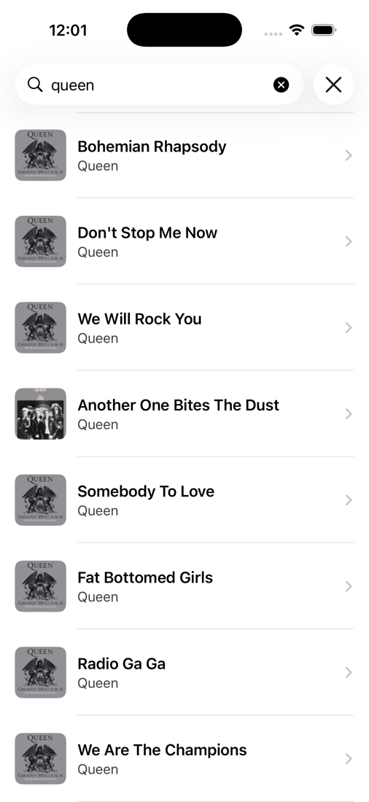
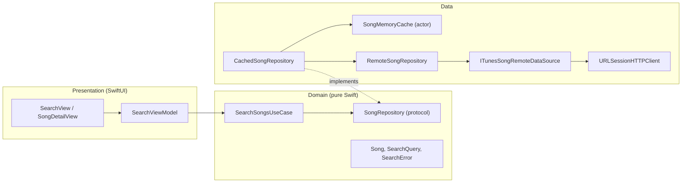
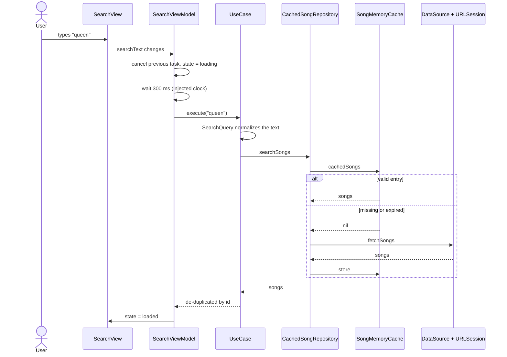
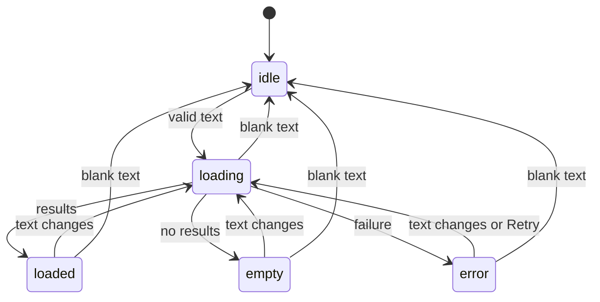
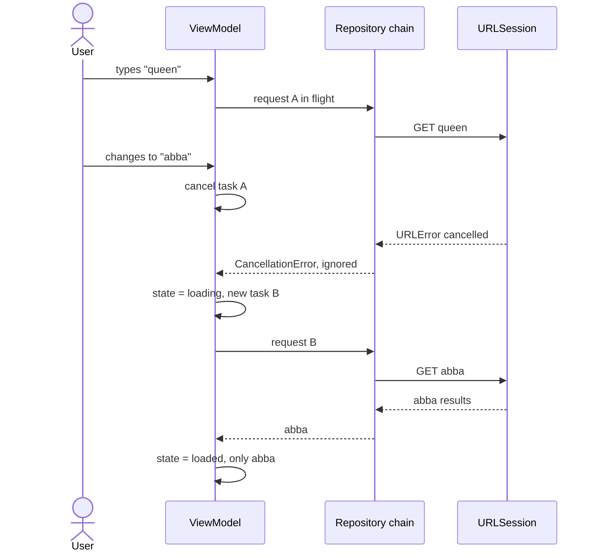
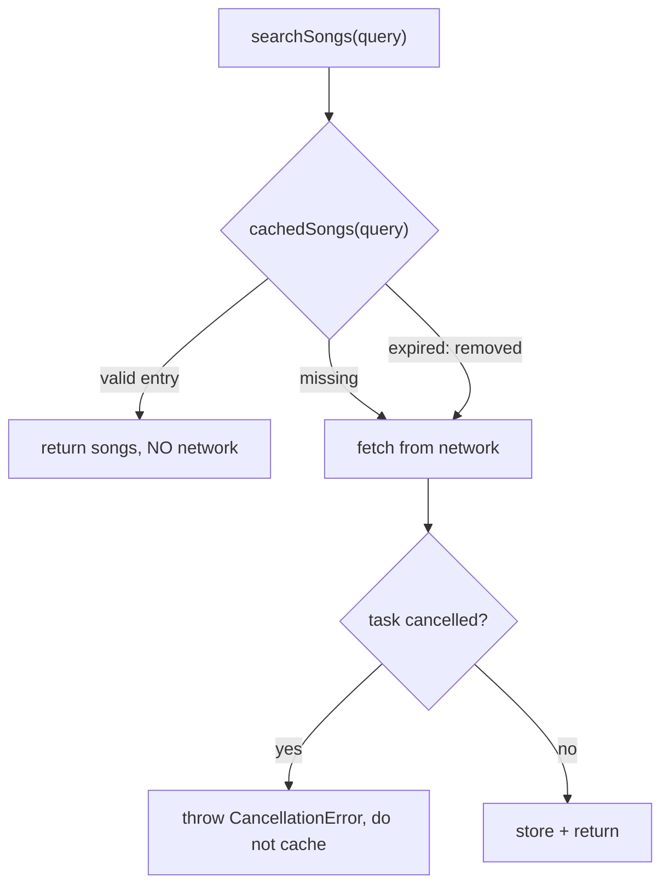

# iTunesSearchApp

A native iOS song-search app: you type, results appear in a list, and tapping a song opens its detail.
Swift 6 (strict concurrency), SwiftUI, iOS 17.6+, no third-party dependencies.

<p>
  
  
  
  
  
</p>

## Public API

[iTunes Search API](https://developer.apple.com/library/archive/documentation/AudioVideo/Conceptual/iTuneSearchAPI/): public, no key, no sign-up. Filtering is done by the server; no `country` is sent, so prices are USD.

```
https://itunes.apple.com/search?term={query}&entity=song&limit=25
```

## How to run

1. Open **`iTunesSearchApp.xcworkspace`** (Xcode 26), not the `.xcodeproj`: the workspace holds the app and the local package `Packages/SearchKit`, and that is what lets ⌘U see the package's tests.
2. Pick the **iTunesSearchApp** scheme and an iOS 17.6+ simulator or device, then run with ⌘R.

### Tests

⌘U in Xcode, or `xcodebuild test -workspace iTunesSearchApp.xcworkspace -scheme iTunesSearchApp -destination 'platform=iOS Simulator,name=iPhone 17'`.

| Target | Framework | What it covers |
|---|---|---|
| `DomainTests` | Swift Testing | Use case against a mocked repository; `SearchQuery` normalization. |
| `DataTests` | Swift Testing | Cache hit, expiry and purge; cancellation down to a real `URLSession` (via a `URLProtocol` stub); status codes, decoding, error mapping. |
| `PresentationTests` | Swift Testing | View model (debounce, cancellation, stale results, VoiceOver announcements), formatting, accessibility texts, String Catalog complete in both languages. |
| `iTunesSearchAppUITests` | XCTest | Search → detail → back, and Apple's accessibility audit on every screen state and at the largest Dynamic Type size. |

No test uses the real network or real sleeping. The first three targets live in `Packages/SearchKit/Tests`, with shared helpers (`ManualClock`, repository spy, fixtures) in `TestSupport`. UI tests run offline: the app is launched with `-UITestStubbedSearch` (Debug only) and uses fixed songs. `iTunesSearchApp.xctestplan` forces English and disables parallel execution, because the unit tests compare English texts.

## Requirements → where they are

| Requirement | Where |
|---|---|
| Search screen with a text field and a results list | `SearchView` (`.searchable` + `List`) |
| Cancel the in-flight search; never show old results | `SearchViewModel` ([Cancellation](#cancellation)) |
| Detail screen with 3+ fields | `SongDetailView`: album, genre, release date, duration, price |
| Data / Domain / Presentation separation | [Architecture](#architecture) |
| Per-query cache with TTL, no network on a hit | `CachedSongRepository` + `SongMemoryCache` (3 min) |
| Domain tests with mocked repositories | `SearchSongsUseCaseTests` + `SongRepositorySpy` |
| Data tests for the cache | `SongMemoryCacheTests`, `CachedSongRepositoryTests` |
| Presentation tests (optional) | `SearchViewModelTests`, `SearchAnnouncementTests`, formatter and accessibility tests |

## Architecture

Three layers, each a module of the local Swift package `Packages/SearchKit`. Dependencies point inwards: `Presentation → Domain ← Data`. **The compiler enforces it**: `Package.swift` gives `Presentation` and `Data` a dependency on `Domain` only, so `Presentation` cannot import `Data`. Only the app target, the composition root, knows all three.



```
iTunesSearchApp/             App target: composition root, UI-test stub, assets
Packages/SearchKit/
  Sources/Domain/            Song, SearchQuery, SearchError, SongRepository, SearchSongsUseCase
  Sources/Data/              HTTP client, DTOs and mapper, iTunes data source, cache, repositories
  Sources/Presentation/      SearchViewModel, SearchView, SongDetailView, components, String Catalog
  Tests/                     DomainTests, DataTests, PresentationTests, TestSupport
iTunesSearchAppUITests/      UI tests
```

- **Domain** imports neither SwiftUI nor anything network-related; it defines the protocols Data implements. Each module exposes only what the composition root needs: DTOs, mapper and endpoint stay `internal` and are tested with `@testable`.
- **Dependency injection** through initializers, with protocols and no singletons. The real graph: `URLSessionHTTPClient → ITunesSongRemoteDataSource → RemoteSongRepository → CachedSongRepository(SongMemoryCache) → DefaultSearchSongsUseCase → SearchViewModel → SearchView`.
- **Swift 6:** immutable `Sendable` structs for entities, an `actor` for the cache, a `@MainActor @Observable` view model.
- **Errors:** network, HTTP and decoding failures become a typed `SearchError` in Data; the UI never sees a raw error, only a localized message and a Retry button.

### One search, end to end



### Screen states

The search screen is always in exactly one of five states (`SearchViewState`), so impossible combinations cannot exist: `idle` shows the welcome prompt, `loading` a progress indicator, `loaded` the list, `empty` the no-results view and `error` a message with **Retry**.



Every arrow into `loading` drops the previous list, empty view or error, so old results are never visible while a new search is pending.

## Decisions

### Cancellation

- Every text change cancels the previous task at once. Blank text goes back to `idle` with no task and no network; anything else waits 300 ms (debounce, on an injected `Clock`) and calls the use case.
- After each `await` the task checks `Task.isCancelled`, so a cancelled search never reaches the screen even if it answers late, and a `CancellationError` is never shown as an error.
- Cancellation reaches the network: `URLError(.cancelled)` is mapped to `CancellationError` in Data, and a test with a real `URLSession` proves the request is actually stopped.



### Cache

- In memory, keyed by `SearchQuery`: trimmed, inner whitespace collapsed, lowercased. Diacritics are **not** folded: "cafe" and "café" can return different results, so they get different entries.
- **TTL 3 minutes**, configurable; an entry whose age equals the TTL is already expired. Time comes from an injected `CacheClock`, so tests check expiry in milliseconds.
- Only successful responses are cached: never errors, never the result of a cancelled request.



`CachedSongRepository` is a stateless decorator around any `SongRepository` that only decides cache or network. It awaits the wrapped repository directly, so cancelling the caller cancels the whole chain down to the request.

### Accessibility and localization

- Each row is one VoiceOver element with a label and hint; artwork is hidden from VoiceOver. Since focus stays in the search field, **every search outcome is announced**: "N songs found", "No songs found" or the error message. An injected announcer makes this testable.
- Dynamic Type: layouts switch from horizontal to vertical stacks at accessibility sizes. The layout also adapts to iPhone landscape and iPad (limited content width; on iPad the search field sits under the title instead of floating in the corner). Contrast is checked by the accessibility audit.
- English and Spanish. The String Catalog lives in `Presentation`, every text is looked up in that module's bundle, and a test checks both languages have the same keys and format specifiers. The app target ships a tiny `InfoPlist.xcstrings`: it is what declares the app as localized, and without it iOS stays in English on a Spanish device, because the app itself would have no Spanish resources.

### Left out on purpose

The brief asks for a simple exercise, so these common extras were considered and dropped:

- **Request coalescing** (sharing one call between identical simultaneous requests): the view model already cancels the previous search and the debounce prevents overlap, so there is a single consumer and nothing to share. It would also complicate cancellation. It would make sense with several consumers of the same query.
- **Cache size limit / LRU:** only expired entries are purged; with a 3-minute TTL the cache does not grow meaningfully in a session.
- **Pagination and image caching:** the API returns up to 25 songs, the brief asks for neither, and artwork uses `AsyncImage` with the system's HTTP cache.
- **A second API call for the detail** (`/lookup`): the detail receives the song the search already returned, because the search response has everything it shows. A second call would add no data, only latency, a loading/error/retry state, cancellation, a failure when offline and more tests. It would make sense if the detail needed data the list lacks (an album's track list) or had to open from an id alone.

## Known limitations

- Open the workspace, not the project: the package's tests only appear in the test plan when the package is in a workspace. The package targets iOS only (`Presentation` uses UIKit), so its tests need a simulator.
- At most 25 results per search; prices are always USD.
- The detail artwork asks for a larger image by replacing `100x100bb` with `600x600bb` in Apple's CDN URL, which depends on that format.
- Accessibility audits were only run in light mode and exempt two iOS-owned controls the app cannot change (the search field's clear button and the keyboard's prediction bar). The Spanish translations have not been reviewed by a native speaker.
